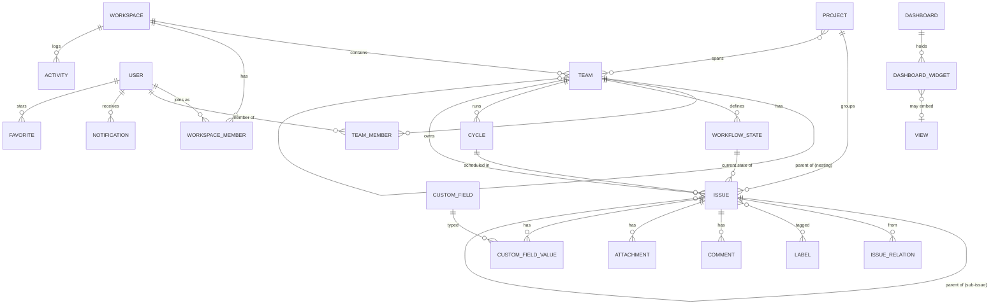
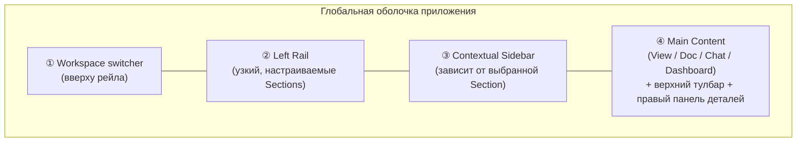
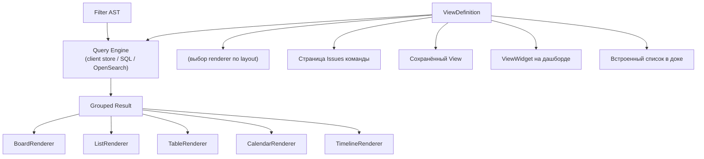
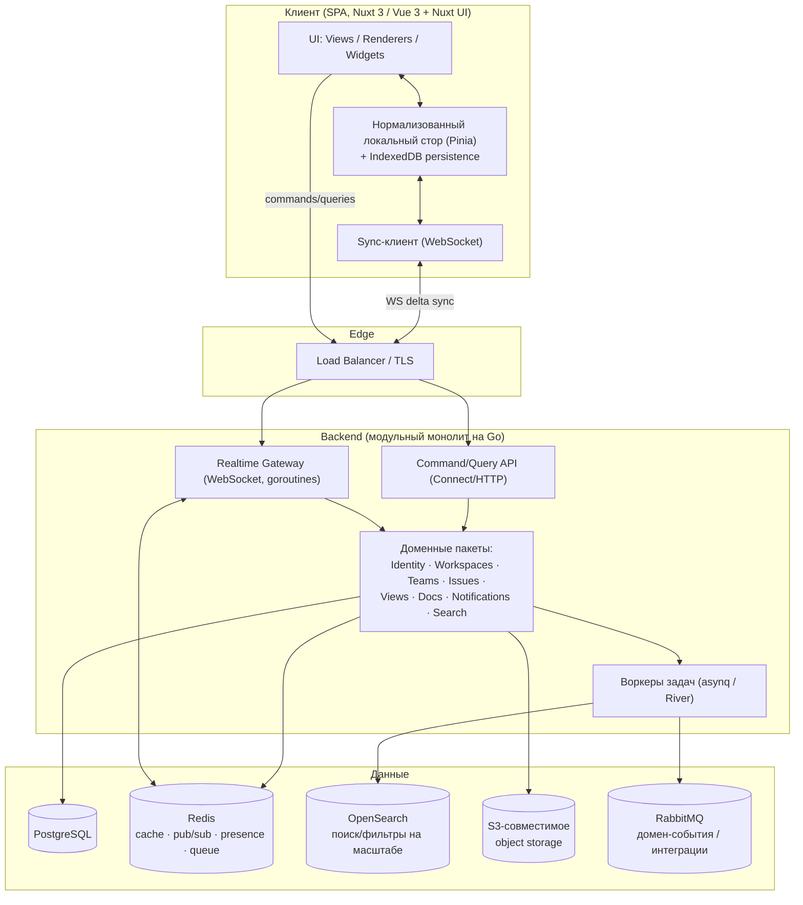
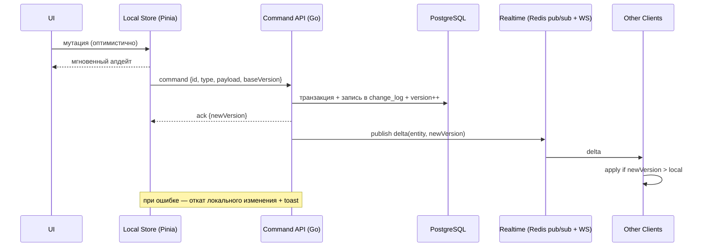

# PMS — Project Management System
## Полная техническая спецификация (ClickUp × Linear)

> Версия документа: 0.1 (draft для анализа и старта реализации)
> Статус: на ревью
> Назначение: единый источник правды по продукту — домен, архитектура, UI/UX, разбивка по версиям, тестирование. На основе этого документа можно делать декомпозицию, оценку и приступать к реализации.

---

## Содержание

1. [Видение, цели, скоуп](#1-видение-цели-скоуп)
2. [Глоссарий и маппинг терминов](#2-глоссарий-и-маппинг-терминов)
3. [Доменная модель](#3-доменная-модель)
4. [Информационная архитектура и навигация](#4-информационная-архитектура-и-навигация)
5. [UI/UX и дизайн-система](#5-uiux-и-дизайн-система)
6. [Реюзабельность: Views, Filter AST, виджеты, дашборды](#6-реюзабельность-views-filter-ast-виджеты-дашборды)
7. [Техническая архитектура](#7-техническая-архитектура)
8. [Функциональная разбивка по версиям](#8-функциональная-разбивка-по-версиям)
9. [Нефункциональные требования](#9-нефункциональные-требования)
10. [Стратегия тестирования](#10-стратегия-тестирования)
11. [Дорожная карта реализации MVP](#11-дорожная-карта-реализации-mvp)
12. [Открытые решения, требующие подтверждения](#12-открытые-решения-требующие-подтверждения)

---

## 1. Видение, цели, скоуп

### 1.1. Что мы строим

PMS — система управления проектами полного цикла. Продукт объединяет две сильные стороны:

- **Глобальный интерфейс и кастомизируемость от ClickUp**: узкий левый рейл с настраиваемым набором разделов (Dashboard, Tasks, Calendar, Chats, Docs, Teams …), переключатель воркспейсов сверху, контекстный сайдбар, зависящий от выбранного раздела, и основная область контента.
- **Модель управления и минимализм от Linear**: воркспейсы → teams (с вложенностью) → у каждой team свои Issues, Cycles (current/upcoming), Views, Docs, Activities; клавиатуро-центричный, быстрый, «тихий» интерфейс без визуального шума.

Ключевая сквозная идея, отличающая продукт: **любой экран собирается из переиспользуемых блоков**. Страница Issues команды, виджет на дашборде, встроенный список в доке, блок чата — это всё инстансы одних и тех же компонентов (View + Renderer). Дашборд = холст, на который можно положить любые блоки: списки issues с фильтрами, канбан, календарь, чаты, метрики.

### 1.2. Цели продукта

- Дать командам единое пространство, закрывающее путь от планирования (issues, cycles, projects) до исполнения и (в поздних версиях) разработки/деплоя (git, CI, web IDE) и AI-ассистирования (MCP).
- Скорость и ощущение «локального» приложения уровня Linear: мгновенный отклик на действия, оптимистичные мутации, фоновая синхронизация.
- Максимальная конфигурируемость рабочего пространства без потери минимализма.

### 1.3. Целевая аудитория

Инженерные и продуктовые команды, малые/средние организации, которым нужен и трекер задач уровня Linear, и гибкость ClickUp, и (в перспективе) встроенный dev-loop. Первичный персонаж — техническая команда, работающая итерациями (cycles), с потребностью в кастомных представлениях.

### 1.4. Скоуп по версиям (краткая карта)

| Версия | Содержание | Главная ценность |
|---|---|---|
| **MVP** | Вся core-модель Linear (teams, issues, cycles, views, projects, labels, sub-issues, relations), отображения Board/List/Table, фильтры/группировки/сортировки, настройки отображения для воркспейса, кастомные поля (база), **Calendar**, реюзабельные блоки и кастомизируемый дашборд, поиск, Inbox/нотификации | Полноценный трекер + кастомизация |
| **v2** | Чаты (каналы, DM, треды), митинги, полная двусторонняя синхронизация календаря и задач, command palette | Коммуникация внутри инструмента |
| **v3** | Git (свои репозитории, пайплайны), интеграция git ↔ issues/projects | Связка планирования и кода |
| **v4** | Тайм-трекеры, web IDE для git, менеджер SSH-соединений, хранилище secrets | Dev-окружение внутри платформы |
| **v5** | Внешние интеграции (GitHub, Slack, AI и т.д.), публичный API/webhooks | Экосистема |
| **v6** | MCP-сервер и собственная AI | Агентная автоматизация |

### 1.5. Принципы проектирования

1. **Local-first ощущение**: чтение/запись — локально и мгновенно, сеть — это фоновая синхронизация, а не блокирующий запрос.
2. **Everything is a View**: данные отделены от способа их отображения; один и тот же набор данных рендерится канбаном/списком/таблицей/календарём.
3. **Композиция вместо страниц**: экраны = композиция блоков; блоки переиспользуемы и встраиваемы.
4. **Минимализм по умолчанию, мощь по требованию**: интерфейс не перегружен; продвинутые возможности раскрываются прогрессивно.
5. **Keyboard-first**: всё ключевое доступно с клавиатуры и через command palette.
6. **Расширяемость как фундамент**: домен, фильтры, кастомные поля и виджеты спроектированы так, чтобы поздние версии (git, AI, интеграции) встраивались без переписывания ядра.

### 1.6. Вне скоупа (явные не-цели)

- Не делаем «ещё один Jira» с тяжёлой конфигурацией воркфлоу-движков с условными переходами на старте — воркфлоу простые (статусы по категориям), сложные правила автоматизации появляются позже.
- На старте — не мультиоблачный self-hosted дистрибутив; сначала единый деплой (см. §12, открытое решение SaaS vs self-host).
- Не строим полноценный «Google Docs» в MVP — доки есть, но богатое многопользовательское совместное редактирование (CRDT) — отдельная веха.

---

## 2. Глоссарий и маппинг терминов

Поскольку продукт сводит вместе словарь Linear и ClickUp (а они называют похожие вещи по-разному), фиксируем единую терминологию проекта. Слева — наш термин, далее — аналоги.

| Термин (наш) | Linear | ClickUp | Определение |
|---|---|---|---|
| **Workspace** | Workspace | Workspace | Верхнеуровневый арендатор (tenant). Граница изоляции данных. Выбирается в дропдауне вверху левого рейла. |
| **Team** | Team | Space / Folder | Организационная единица внутри воркспейса. **Поддерживает вложенность** (team внутри team). Владеет issues, cycles, views, docs. Имеет уникальный ключ (напр. `BLD`). |
| **Section** | (нет прямого) | Sidebar item | Пункт глобальной навигации в левом рейле (Dashboard, Tasks, Calendar, Chats…). Набор и порядок настраиваются. |
| **Issue** | Issue | Task | Основная единица работы. Имеет человекочитаемый идентификатор `KEY-N` (напр. `BLD-6885`). |
| **Sub-issue** | Sub-issue | Subtask | Дочерний issue (иерархия parent → children). |
| **Project** | Project | List / Project | Группировка issues вокруг цели; может охватывать несколько teams. |
| **Cycle** | Cycle | Sprint | Тайм-боксированная итерация команды (current/upcoming). Источник burndown/velocity. |
| **Workflow State** | Workflow status | Status | Статус issue, сгруппированный по **категории** (backlog/unstarted/started/completed/canceled). Настраивается per-team. |
| **Label** | Label | Tag | Метка для классификации (Bug, MCP, Migrated…). |
| **Estimate** | Estimate | (points) | Оценка трудоёмкости (story points). |
| **Priority** | Priority | Priority | Приоритет: none/low/medium/high/urgent. |
| **View** | View | View | Сохранённое представление: источник данных + фильтр + группировка + сортировка + layout + видимые поля. |
| **Layout / Renderer** | Board/List/… | Board/List/Calendar… | Способ отображения результата View. |
| **Dashboard** | (Insights) | Dashboard | Холст из виджетов. |
| **Widget** | — | Card | Встраиваемый блок на дашборде (View / chat / doc / metric / chart / note / embed). |
| **Doc** | Document | Doc | Документ (rich text), привязан к team/project, поддерживает вложенность. |
| **Activity** | Activity / History | Activity | Лента событий/аудит изменений. |
| **Inbox** | Inbox | Notifications | Персональный поток уведомлений. |
| **Member / Membership** | Member | Member | Пользователь и его роль в воркспейсе/команде. |
| **Custom Field** | Custom property | Custom Field | Пользовательское поле произвольного типа на issue/project. |
| **Filter AST** | (внутр.) | (внутр.) | Сериализуемое дерево предикатов фильтрации. Общий язык для views, виджетов, поиска. |

Конвенции идентификаторов: внутренний ID — UUID (v7, k-sortable); внешний — `<TEAM_KEY>-<N>`, где `N` — порядковый номер issue **в пределах команды** (см. §3.5).

---

## 3. Доменная модель

Здесь — состав сущностей, их зона ответственности и связи (без детализации полей; схемы таблиц прорабатываются на этапе реализации). Тип «rich text» = структурированный документ (ProseMirror/TipTap JSON) в JSONB.

### 3.1. Карта связей



### 3.2. Каталог сущностей

**Идентичность и доступ**

| Сущность | За что отвечает | Ключевые связи |
|---|---|---|
| **User** | Глобальная учётная запись; состоит в нескольких воркспейсах | → WorkspaceMember, TeamMember |
| **Workspace** | Арендатор (tenant), граница изоляции данных | содержит Teams, Members и всё остальное |
| **WorkspaceMember** | Роль пользователя в воркспейсе (owner/admin/member/guest) | связь User ↔ Workspace |

**Команды и конфигурация**

| Сущность | За что отвечает | Ключевые связи |
|---|---|---|
| **Team** | Орг-единица **с вложенностью**; владеет issues/cycles/views/docs; ключ для идентификаторов | self-FK (parent), → Workspace; владеет WorkflowState, Cycle, Issue |
| **TeamMember** | Членство и роль (lead/member) в команде | User ↔ Team |
| **WorkflowState** | Статус по категории (backlog/unstarted/started/completed/canceled), per-team; категория управляет проставлением started/completed | → Team; используется Issue |
| **Label** | Метка классификации (scope workspace/team, группы лейблов) | ↔ Issue (m2m) |

**Рабочие элементы**

| Сущность | За что отвечает | Ключевые связи |
|---|---|---|
| **Issue** | Основная единица работы; идентификатор `KEY-N`; иерархия (sub-issues) | → Team, WorkflowState, Cycle, Project, assignee (User); ↔ Label; → Comment, Attachment, IssueRelation, CustomFieldValue |
| **IssueRelation** | Типизированные связи между issues (blocks/blocked-by/related/duplicate) | Issue ↔ Issue |
| **CustomField / CustomFieldValue** | Пользовательские поля и их типизированные значения | Field → значения на Issue |

**Планирование**

| Сущность | За что отвечает | Ключевые связи |
|---|---|---|
| **Project** | Группировка вокруг цели; охватывает несколько команд; status/health/target | → Issue; ↔ Team (m2m); → Milestone |
| **Milestone** | Веха внутри проекта | → Project |
| **Cycle** | Итерация команды (current/upcoming); источник burndown/velocity | → Team; ↔ Issue; прогресс-снапшоты |

**Представления и дашборды**

| Сущность | За что отвечает | Ключевые связи |
|---|---|---|
| **View** | Сохранённое представление: источник + Filter AST + группировка/сортировка + layout + видимые поля + scope | scope → Workspace/Team/Project |
| **Dashboard / DashboardWidget** | Холст из виджетов; виджет встраивает View / chat / doc / metric / chart / note / embed | Widget → View (опц.) |
| **Favorite** | «Звёздочки» на любые сущности (per-user) | User → любая сущность |

**Контент и коллаборация**

| Сущность | За что отвечает | Ключевые связи |
|---|---|---|
| **Document** | Rich-text документ, дерево вложенности; привязан к team/project | → Team/Project; → Comment |
| **Comment** | Комментарии с тредами и реакциями (polymorphic) | → Issue / Doc / Project |
| **Attachment** | Файлы и внешние ссылки (PR/Figma) с метаданными | → Issue / Doc |
| **Activity** | Аудит-лог и ленты активности (actor/action/diff/время) | → Workspace |

**Платформа**

| Сущность | За что отвечает | Ключевые связи |
|---|---|---|
| **Notification / NotificationPreference** | Inbox и настройки доставки уведомлений | → User |
| **Subscription / Reaction** | Подписчики issue; эмодзи-реакции | → Issue / Comment |

**Расширения (заглушки под поздние версии)**

| Версия | Сущности |
|---|---|
| v2 | `Channel`, `Message` (чаты/треды), `Meeting`, `CalendarEvent` (с RRULE, привязкой к issue) |
| v3 | `Repository`, `Branch`, `PullRequest` (связь с issues по `KEY-N`), `Pipeline`, `PipelineRun`, `Job` |
| v4 | `TimeEntry`, `Secret`/`SecretStore`, `SshConnection`, `WebIdeSession` |
| v5 | `Integration`, `IntegrationInstall`, `Webhook` |
| v6 | `McpServerConfig`, `AiThread`, `AiAction` (предложенная агентом мутация → требует подтверждения) |

### 3.3. Ключевые модельные решения

- **Вложенность команд.** Issue принадлежит **ровно одной** команде (владелец) + опциональный rollup в родителя через флаг во View; членство наследуется для public-дочерних. Это сохраняет простую нумерацию и предсказуемые права. Вариант «issue в нескольких командах» сознательно отвергнут.
- **Идентификаторы issue** — `KEY-N`, порядковый номер **в пределах команды**; атомарный счётчик на команду, дыры в нумерации допустимы (проще и быстрее).
- **Ручной порядок** (колонки board, backlog, sub-issues) — **fractional indexing** (перестановка элемента без перенумерации соседей).
- **Кастомные поля** — типизированные значения в JSONB, индексируются для фильтрации (на масштабе — проекция в OpenSearch).
- **Конфликты синхронизации** — per-field last-write-wins для структурных полей; CRDT для свободного текста (доки/описания) выделен в отдельную веху.

---

## 4. Информационная архитектура и навигация

### 4.1. Четыре зоны интерфейса

Синтез ClickUp (узкий рейл разделов + контекстный сайдбар) и Linear (дерево команд + минимализм):



**① Workspace switcher** — дропдаун вверху левого рейла: текущий воркспейс, переключение, «Manage», «Create workspace», «Invite people», глобальные настройки. Смена воркспейса перезагружает синхронизируемый набор данных (см. §7.4).

**② Left Rail (узкий)** — глобальная навигация по **Sections**. Section — это пункт верхнего уровня: `Inbox`, `My Issues`, `Dashboards`, `Teams` (дерево команд), `Calendar`, `Chats`, `Docs`, `Projects`, `Views`, `Settings`, плюс пользовательские. Пользователь **выбирает, какие Sections показывать, и их порядок** (drag-and-drop, как настраиваемая полоса ClickUp). Конфиг хранится per-user-per-workspace.

**③ Contextual Sidebar** — содержимое зависит от активной Section:
- Section `Teams` → дерево команд; у каждой раскрываемой команды подпункты `Issues`, `Cycles` (`Current` / `Upcoming`), `Views`, `Docs`, `Activities` — ровно как в Linear (см. референс 1). Вложенные команды раскрываются рекурсивно.
- Section `Calendar` → источники/фильтры календаря, мини-месяц, переключатель «мои/команда».
- Section `Chats` → список каналов + DM (как референс 2: Channels / Direct Messages / Spaces).
- Section `Dashboards` → список дашбордов + «избранное».
- Section `Inbox` / `My Issues` → фильтры потока.

**④ Main Content** — собственно рабочая область: рендер View (Board/List/Table/Calendar/Timeline), документ, чат или дашборд. Имеет:
- **Верхний тулбар**: путь (breadcrumbs `Build › Cycles › Cycle 1`), счётчик («38 issues»), кнопки Filter / Display options / переключатель layout / поиск.
- **Опциональный правый панель деталей**: свойства выбранной сущности или, как на референсе Linear, сводка по cycle (Progress: Scope/Started/Completed, burndown-график, разбивка по assignees).

### 4.2. Карта навигации (sitemap)

```
Workspace
├── Inbox (нотификации)
├── My Issues (assigned/created/subscribed)
├── Dashboards
│   └── <Dashboard> → виджеты (views, chats, charts, notes…)
├── Teams
│   └── <Team> (вложенно)
│       ├── Issues  → дефолтный View команды
│       ├── Cycles → Current | Upcoming | <Cycle>
│       ├── Views → <Saved View>
│       ├── Docs → <Doc> (вложенно)
│       └── Activities (лента событий команды)
├── Projects
│   └── <Project> → Overview | Issues | Docs | Milestones
├── Calendar (issues по датам; v2: + events/meetings)
├── Chats (v2)
├── Docs (глобальные)
├── Views (глобальные сохранённые)
└── Settings (workspace / teams / members / labels / states / custom fields / integrations)
```

### 4.3. URL-схема (deep-linking)

Каждое состояние адресуемо (важно для шаринга и навигации):
```
/w/:workspaceSlug
/w/:workspaceSlug/inbox
/w/:workspaceSlug/my/issues
/w/:workspaceSlug/team/:teamKey/issues
/w/:workspaceSlug/team/:teamKey/cycles/:cycleId
/w/:workspaceSlug/team/:teamKey/view/:viewId
/w/:workspaceSlug/issue/:identifier        (напр. /issue/BLD-6885)
/w/:workspaceSlug/project/:projectId
/w/:workspaceSlug/dashboard/:dashboardId
/w/:workspaceSlug/calendar
/w/:workspaceSlug/doc/:docId
```
Открытие issue — это modal/overlay поверх текущего контекста (как в Linear), но с собственным URL (можно открыть напрямую). Состояние фильтров/группировок временного (несохранённого) View кодируется в query-параметрах для шаринга.

---

## 5. UI/UX и дизайн-система

### 5.1. Визуальный язык

Эстетика — **минимализм уровня Linear**: высокая плотность информации, спокойная типографика, отсутствие лишних рамок и теней, акцент на контенте. Цвет используется функционально (статусы, приоритеты, лейблы), а не декоративно.

### 5.2. Тема и токены

**На старте — только тёмная тема, без переключения тем.** Палитра, типографика и spacing зашиты в дизайн-токены (через app config Nuxt UI + Tailwind), поэтому в будущем можно добавить светлую/кастомные темы без переделок — но сейчас это вне скоупа.

- **Цвет**: семантические токены (`bg-base`, `bg-elevated`, `bg-hover`, `border-subtle`, `text-primary/secondary/tertiary`, `accent`) + палитры статусов/приоритетов/лейблов. Лейблы и статусы хранят цвет как **ссылку на токен**, не как hex (чтобы будущая смена тем не ломала данные).
- **Типографика**: один гротеск (например Inter / системный стек), чёткая шкала (12/13/14/16/20/24), межстрочные интервалы под плотные списки.
- **Spacing/радиусы/тени**: шкала 4-pt; минимальные радиусы (4–6px); тени почти не используются (только overlay/popover).
- **Иконки**: один монохромный набор, наследует `currentColor`.
- **Плотность**: `comfortable` / `compact` (влияет на высоту строк списков).

### 5.3. Компонентная база

Основа — **Nuxt UI** (поверх Reka UI + Tailwind): даёт готовые доступные примитивы — Button, Dropdown/Menu, Popover, Tooltip, Modal, Command (палитра), Combobox, Select, Checkbox, Switch, Avatar, Badge, Tabs, Toast, Skeleton и т.д.

Поверх примитивов — **доменные компоненты** (переиспользуются повсеместно): `IssueRow`, `IssueCard`, `StatusSelect`, `PrioritySelect`, `AssigneePicker`, `LabelPicker`, `EstimatePicker`, `DatePicker`, `CycleSelect`, `FilterBar`, `DisplayOptionsMenu`, `BurndownChart`, `ProgressBar`, `PropertyPanel`, `RichTextEditor` (TipTap для Vue), `MentionInput`.

То, что Nuxt UI не покрывает из коробки (DataGrid/таблица, Tree для дерева команд, Calendar, Timeline/Gantt, grid дашбордов), реализуется кастомными компонентами или специализированными Vue-библиотеками (см. §7.2).

### 5.4. Ключевые UX-паттерны

- **Optimistic UI**: любое изменение применяется мгновенно локально; откат при ошибке сервера с тостом.
- **Inline-редактирование**: правка свойств прямо в строке/карточке.
- **Drag-and-drop**: между колонками board, реордеринг в списках, перетаскивание в календаре (смена даты).
- **Multi-select + bulk actions**: выбор нескольких issues (shift/cmd-клик), массовые изменения, в т.ч. с клавиатуры.
- **Keyboard-first**: горячие клавиши на всё (создать `C`, назначить `A`, статус `S`, приоритет `P`, навигация `J/K`); подсказки в UI; полноценный command palette в v2 (базовый create/quick-switch желателен уже в MVP).
- **Progressive disclosure**: продвинутые опции спрятаны в Display options, не засоряют основной экран.
- **Empty states / onboarding**: осмысленные пустые состояния с CTA.
- **Undo**: деструктивные действия (архив/удаление) — с тостом «Undo».

### 5.5. Состояния и обратная связь

Скелетоны при первичной загрузке; после первой синхронизации — мгновенный рендер из локального стора. Ненавязчивый индикатор статуса синхронизации (онлайн/оффлайн/догоняем). Presence (кто смотрит/печатает) — для v2 (чаты, совместное редактирование).

### 5.6. Адаптивность

Десктоп-first. На узких ширинах контекстный сайдбар коллапсируется в overlay, правый панель деталей — в выезжающую панель. Полноценный мобильный клиент — за рамками первых версий (компоненты проектируются с прицелом на переиспользование).

### 5.7. Доступность (a11y)

Клавиатурная навигация по всем элементам, корректный фокус-менеджмент в модалках/меню, ARIA-роли (особенно для DataGrid, Tree, Menu, Command), контраст по WCAG AA, уважение `prefers-reduced-motion`. Базовая семантика обеспечивается примитивами Nuxt UI / Reka UI.

---

## 6. Реюзабельность: Views, Filter AST, виджеты, дашборды

Это ядро отличительной идеи продукта. Цель: страница Issues команды, сохранённый View, виджет на дашборде и встроенный список в доке — **один и тот же механизм**.

### 6.1. Модель «View»

View — декларативное описание «что показать и как». Рендер делится на два слоя: **источник данных + запрос** (что) и **layout-renderer** (как).

```ts
type DataSource = 'issue' | 'doc' | 'project' | 'cycle' | 'activity' /* расширяемо */;
type Layout = 'board' | 'list' | 'table' | 'calendar' | 'timeline';

interface ViewDefinition {
  id: string;
  dataSource: DataSource;
  scope: { kind: 'workspace' | 'team' | 'project' | 'personal'; teamId?: string; projectId?: string };
  filter: FilterNode;                 // дерево предикатов (см. 6.2)
  grouping?: GroupSpec;               // напр. по status / assignee / priority / cycle / label / custom field
  subGrouping?: GroupSpec;            // вторичная группировка (swimlanes)
  ordering: OrderSpec[];              // сортировка (поле + направение) с поддержкой ручного порядка
  layout: Layout;
  layoutOptions?: LayoutOptions;      // напр. колонки board = значения группировки; видимые поля
  displayProperties: PropertyKey[];   // какие свойства показывать в строке/карточке
  options?: {
    rollupDescendants?: boolean;      // включать issues дочерних команд
    showSubIssues?: 'nested' | 'flat' | 'hidden';
    showCompleted?: boolean | 'recent';
    density?: 'comfortable' | 'compact';
  };
}
```

Дефолтная страница «Issues» команды — это просто `ViewDefinition` с `dataSource:'issue'`, `scope:{team}`, пустым/преднастроенным фильтром, `grouping:'status'`, `layout:'board'|'list'`. Никакого спец-кода для неё нет.

### 6.2. Filter AST — единый язык фильтрации

Сериализуемое булево дерево предикатов. Один и тот же AST используется во views, виджетах, глобальном поиске и сохранённых фильтрах. Это даёт переносимость и единый движок исполнения (на клиенте — над локальным стором; на сервере — компиляция в SQL/OpenSearch).

```ts
type FilterNode =
  | { type: 'and'; children: FilterNode[] }
  | { type: 'or'; children: FilterNode[] }
  | { type: 'not'; child: FilterNode }
  | { type: 'predicate'; field: FieldRef; op: Operator; value: FilterValue };

type FieldRef =
  | { kind: 'builtin'; key: 'status' | 'assignee' | 'priority' | 'label' | 'cycle'
        | 'project' | 'creator' | 'createdAt' | 'updatedAt' | 'dueDate' | 'estimate'
        | 'state.category' | 'hasRelation' | 'parent' | 'subscriber' /* … */ }
  | { kind: 'custom'; fieldId: string };               // кастомное поле

type Operator =
  | 'eq' | 'neq' | 'in' | 'nin'                         // равенство / множества
  | 'lt' | 'lte' | 'gt' | 'gte'                         // сравнения (числа/даты)
  | 'contains' | 'startsWith'                           // текст
  | 'isSet' | 'isNotSet'                                // наличие значения
  | 'before' | 'after' | 'withinNext' | 'withinPast';   // относительные даты

type FilterValue = string | number | boolean | string[] | RelativeDate | null;
// RelativeDate: { unit: 'day'|'week'|'month'; amount: number } — для «due within next 7 days» и т.п.
```

Требования к движку:
- **Исполнение на клиенте** над нормализованным локальным стором (мгновенная фильтрация без сервера).
- **Компиляция на сервере** в SQL (для server-side представлений/экспорта) и в OpenSearch-запросы (для масштаба/полнотекста). Один AST → два компилятора; покрывается контрактными тестами на эквивалентность результатов.
- Поддержка кастомных полей (предикаты по `CustomFieldValue`).
- Валидация AST по схеме `dataSource` (какие поля/операторы допустимы).

### 6.3. Layout-renderer'ы

Все renderer'ы потребляют **одинаковый** результат запроса (отфильтрованный, сгруппированный, отсортированный набор) — отличается только визуализация:

| Renderer | Что делает | Особенности |
|---|---|---|
| **BoardRenderer** | Канбан; колонки = значения `grouping` | DnD между колонками меняет поле группировки (напр. status); вертикальный порядок = `board_position` (fractional) |
| **ListRenderer** | Сгруппированный список (как референс ClickUp) | Виртуализация; inline-edit; раскрываемые группы; sub-issues nested |
| **TableRenderer** | Таблица/спредшит | Колонки = свойства + кастомные поля; ресайз/реордер колонок; сортировка по клику |
| **CalendarRenderer** | Сетка месяц/неделя | Issues по `scheduled_date`/`due_date`; DnD = смена даты; v2: + events/meetings |
| **TimelineRenderer** | Gantt-подобная шкала | Полосы по `start_date`→`target/due`; зависимости (relations) как стрелки; вехи проектов |

Контракт renderer'а:
```ts
interface ViewRenderer {
  layout: Layout;
  supportedGroupings: FieldRef['kind'][];          // какие группировки умеет
  render(props: { result: GroupedResult; def: ViewDefinition; onMutate: MutateFn }): VNode;
}
```
Добавление нового способа отображения = новый renderer, без изменения модели View или движка фильтров.

### 6.4. Виджеты и дашборды (кастомизируемый холст)

Дашборд — это **сетка виджетов** (resizable grid). Каждый виджет — обёртка над контентом; ключевой тип виджета `view` встраивает любой `ViewDefinition`, благодаря чему «напихать на главную разные views/issues с фильтрами/блок чата» — это композиция, а не спец-страница.

```ts
type WidgetType = 'view' | 'chat' | 'doc' | 'stat' | 'chart' | 'note' | 'embed';

interface WidgetConfig {
  id: string;
  type: WidgetType;
  layout: { x: number; y: number; w: number; h: number };  // позиция в grid
  title?: string;
  config:
    | { type: 'view'; viewId?: string; inline?: ViewDefinition } // встроенный View (ссылка или инлайн-определение)
    | { type: 'chat'; channelId: string }                       // блок канала (v2)
    | { type: 'doc'; docId: string }                            // встроенный документ
    | { type: 'stat'; metric: MetricSpec }                      // одно число (напр. «open bugs»)
    | { type: 'chart'; chart: ChartSpec }                       // burndown/velocity/кастом-агрегация
    | { type: 'note'; markdown: string }                        // заметка
    | { type: 'embed'; url: string };                           // внешний iframe
}
```

Свойства:
- **Один компонент — много мест.** `ViewWidget` рендерит ровно те же `BoardRenderer/ListRenderer/...`, что и полноэкранная страница. Нет дублирующего кода.
- **Grid-layout**: drag/resize виджетов (например на базе grid-layout-plus), сохранение в `Dashboard.grid`.
- **Скоуп дашборда**: personal / team / workspace; шаринг как у views.
- **Метрики/чарты**: `MetricSpec`/`ChartSpec` описывают агрегацию поверх того же Filter AST (count/sum/avg/group-by по полю), что даёт консистентность с фильтрами.

### 6.5. Принцип композиции (резюме)



Любая точка интерфейса, показывающая данные, — это `ViewDefinition` + renderer. Это и есть требование «каждый скрин реюзабелен».

---

## 7. Техническая архитектура

### 7.1. Контейнерная диаграмма (high-level)



### 7.2. Выбор стека

**Frontend**
- **Nuxt 3 + Vue 3 + TypeScript**; **Nuxt UI** (на Reka UI + Tailwind) как компонентная библиотека. Тёмная тема по умолчанию (§5.2).
- **Состояние**: **Pinia** как нормализованный локальный стор + персистенс в **IndexedDB** (`idb` / плагин персистенса). Сервер-стейт несинхронизируемых эндпоинтов — `useFetch`/`$fetch` Nuxt (при желании — TanStack Query для Vue или Pinia Colada).
- **Rich text**: TipTap (Vue-биндинги). **DnD**: pragmatic-drag-and-drop (framework-agnostic) или vue-draggable-plus. **Виртуализация**: `@tanstack/vue-virtual` или vue-virtual-scroller. **Grid дашбордов**: grid-layout-plus. **Графики**: `@unovis/vue` или vue-echarts. **Календарь**: кастомный под минимал-стиль (или Schedule-X / FullCalendar Vue). **Роутинг**: встроенный файловый роутинг Nuxt.

**Backend (Go)**
- **Go (Golang)** — модель конкурентности (goroutines/channels) идеально ложится на WS-шлюз и sync-слой (это сильная сторона относительно тяжёлых рантаймов); один бинарь, простой деплой в Docker/k8s.
- **HTTP/роутинг**: `net/http` + **chi** (лёгкий, идиоматичный, композируемые middleware) или echo.
- **Контракты фронт↔бек**: **ConnectRPC (Connect-Go)** + кодген TS-клиента → end-to-end типобезопасность команд/запросов и Filter AST (заменяет «руками поддерживаемые shared-типы»). Поддерживает стриминг — удобно для потока дельт. Альтернатива — REST + OpenAPI-кодген.
- **БД**: PostgreSQL через **pgx**; статические запросы — **sqlc** (типобезопасный SQL→Go); динамические (компилятор Filter AST) — query-builder (squirrel/bun) или ручная сборка SQL. Альтернатива — **ent** (граф-ориентированная ORM, удобна под вложенные команды и связи).
- **Миграции**: golang-migrate / goose / Atlas.
- **Очереди/джобы**: **asynq** (Redis-backed, есть дашборд — роль аналогична Horizon) для MVP; **River** (Postgres-backed) как альтернатива; RabbitMQ — когда появляются интеграции (v3/v5).
- **Realtime**: WebSocket на `coder/websocket` (ex nhooyr) или gorilla/websocket; fan-out через Redis pub/sub; presence в Redis.
- **Поиск**: OpenSearch (официальный Go-клиент). **Object storage**: S3-совместимое (`aws-sdk-go-v2` / `minio-go`).
- **Auth**: opaque-токены в Redis или JWT + сессии; OAuth/SAML/SCIM и 2FA — позже (`golang.org/x/oauth2`, goth).
- **Прочее**: валидация — `go-playground/validator`; конфиг — env/viper; логирование — `slog` (stdlib); наблюдаемость — OpenTelemetry (в Go отлично поддержан).

**Данные (роли неизменны)**: PostgreSQL (primary store, JSONB под кастомные поля/настройки/rich text, оконные функции для метрик), Redis (кэш/очередь/pub-sub/presence), RabbitMQ (асинхронные домен-события и интеграции — включается в v3/v5), OpenSearch (полнотекст/фильтры на масштабе), object storage (вложения).

### 7.3. Доменные модули (границы внутри монолита)

Модульный монолит как Go-пакеты (`internal/<domain>`); общение между модулями — через сервисы/события, без прямого доступа к чужим таблицам. Это делает будущую экстракцию в отдельные сервисы (git-хостинг, CI-раннеры, web IDE, AI/MCP — поздние версии) дешёвой.

| Модуль | Ответственность |
|---|---|
| **Identity** | users, аутентификация, сессии, 2FA |
| **Workspaces** | воркспейсы, members, роли, настройки, billing (позже) |
| **Teams** | команды (вложенность), team-members, workflow states, cycles config |
| **Issues** | issues, sub-issues, relations, labels, estimates, нумерация, порядок |
| **Projects** | проекты, milestones, project-team связи |
| **Views** | сохранённые views, dashboards, widgets, валидация Filter AST |
| **Query** | исполнение Filter AST: компиляция в SQL/OpenSearch, агрегации |
| **Docs** | документы, дерево доков, (позже) совместное редактирование |
| **Comments/Activity** | комментарии, реакции, аудит-лог, ленты активности |
| **Notifications** | генерация уведомлений, Inbox, preferences, доставка |
| **Realtime** | presence, broadcast дельт, каналы подписки (goroutine на соединение) |
| **Search** | индексация в OpenSearch, глобальный поиск, quick-switch |
| **Files** | загрузка/выдача вложений, превью |

### 7.4. Синхронизация и local-first (ключевое архитектурное решение)

Скорость уровня Linear обеспечивается не «быстрым API», а **локальной моделью данных**: релевантный срез воркспейса синхронизируется на клиент, чтения/записи идут к локальному стору мгновенно, сеть выполняет фоновую сверку. Самое важное и самое затратное решение продукта. Go здесь — преимущество: WS-шлюз и sync-слой естественно строятся на goroutine/channel.

**Поэтапная стратегия (без переписывания ядра):**

**Этап А — «оптимистичный UI + delta-sync» (MVP).**
- Клиент при входе делает первичную загрузку среза (issues/states/cycles/labels/views доступных команд) → нормализованный стор (Pinia) + IndexedDB.
- Все мутации — оптимистичные: применяются локально сразу, отправляются как **команды** с client-generated UUID (идемпотентность).
- Сервер по факту изменения публикует **дельту сущности** (изменённые поля + новая `version`) в канал воркспейса/команды; подключённые клиенты применяют дельту, если она новее.
- Догон после оффлайна: при реконнекте клиент запрашивает изменения `since=<cursor>` (таблица `change_log`), применяет пропущенное, затем доигрывает свою очередь отложенных мутаций.

**Этап Б — «настоящий local-first» (апгрейд под полное оффлайн/мгновенность на больших объёмах).**
- Переход на специализированный sync-движок поверх Postgres. Кандидаты **backend-agnostic** (сидят рядом с Postgres, совместимы с Go-бэком): **ElectricSQL** или **PowerSync** (Postgres ↔ локальный SQLite/PGlite). Вариант **Rocicorp Zero** мощнее, но сильнее завязан на собственный sync-сервис.
- Подготовка к апгрейду: клиентский стор изолирован за интерфейсом репозитория (`StoreGateway`), мутации идут через единый `command bus` — транспорт/движок подменяемы без переписывания UI и доменной логики.

**Поток данных (Этап А):**


**Конфликты.**
- Структурированные поля issue/project — **per-field last-write-wins** по `version`/`updated_at`; команды несут `baseVersion`, сервер разрешает по полям (не теряя несвязанные изменения).
- Свободный текст (описания, доки, сообщения) — **CRDT (Yjs)** на уровне контента поля/документа; отдельная веха. В MVP описания — LWW по всему полю (достаточно для одиночной правки).

### 7.5. Realtime в деталях

- **Транспорт**: WebSocket; аутентификация по токену при апгрейде соединения; на сервере — goroutine на соединение.
- **Каналы подписки**: `workspace:{id}`, `team:{id}`, `issue:{id}` (открытый issue), `presence:{entity}`. Подписки управляются клиентом в зависимости от открытого экрана.
- **Fan-out**: несколько инстансов WS-шлюза; сообщения распространяются через Redis pub/sub, чтобы клиент на любом инстансе получил дельту.
- **Presence**: эфемерное состояние в Redis (TTL + heartbeat) — кто смотрит/печатает.
- **Throttling/батчинг**: дельты батчатся (окно ~50–100мс), чтобы массовые операции не штормили клиентов.

### 7.6. API-стратегия

- **Внутренний (для собственного клиента)**: разделение **commands** (типизированные действия `CreateIssue`, `UpdateIssueState`, `ReorderIssue`, `AddLabel`… — не CRUD на каждую таблицу) и **sync/query** (чтение + поток дельт). Это даёт идемпотентность, аудит и оптимистичные мутации.
- **Контракты**: схемы команд и Filter AST описываются в protobuf и компилируются в Go-типы и TS-клиент через **ConnectRPC** — единый источник истины для фронта и бэка. (Альтернатива — REST + OpenAPI-кодген.)
- **Публичный API (v5)**: документированный REST и/или GraphQL для интеграций; исходящие webhooks; OAuth-приложения; rate limiting; версионирование.

### 7.7. Права доступа (RBAC + видимость)

| Уровень | Роли / правила |
|---|---|
| **Workspace** | `owner` (всё, биллинг, удаление воркспейса), `admin` (управление членами/настройками), `member` (обычная работа), `guest` (только явно расшаренное/назначенное) |
| **Team** | приватность (`public`/`private`); роли `lead`/`member`; private-команды не видны не-членам |
| **Resource** | issue наследует видимость команды; doc/dashboard/view — собственный scope (personal/team/workspace) + флаг shared |
| **Inheritance (вложенность)** | по умолчанию: член родительской команды видит public-дочерние; private-дочерние требуют явного членства. Политика конфигурируема на воркспейс |

Реализация: серверный policy-слой (Go) как единственный источник истины; клиент получает **производную permission-карту** для гейтинга UI (сервер всегда перепроверяет). Все мутации проходят авторизацию на уровне команды/ресурса.

### 7.8. Многоарендность и изоляция

- Tenant = workspace. Каждая доменная таблица несёт `workspace_id`; запросы всегда скоупятся по нему.
- Индексы строятся с ведущим `workspace_id`/`team_id` под основные паттерны доступа.
- На масштабе — заложена возможность шардирования по `workspace_id` (не реализуется на старте).

### 7.9. Производительность и кэш

- Горячие справочники (states, labels, members, teams) — в синк-срезе на клиенте и в Redis на сервере.
- Тяжёлые агрегации (метрики cycle, дашборд-чарты) считаются на сервере с кэшем и/или инкрементально через снапшоты (`cycle_progress_snapshots`).
- Списки виртуализируются на клиенте; первичная синхронизация — прогрессивная (сначала открытая команда/представление, остальное фоном).

---

## 8. Функциональная разбивка по версиям

Глубина детализации убывает с номером версии: MVP/v2 расписаны как требования к реализации, v3–v6 — как направления с фиксацией точек интеграции (детальные спеки пишутся ближе к делу). Принцип: каждая версия должна встраиваться в ядро без его переписывания.

### 8.1. MVP — ядро Linear + Calendar + кастомизация

**Цель:** полноценный трекер с представлениями, фильтрами, кастомизацией и календарём; локально-быстрый.

**8.1.1. Управление пространством**
- Создание/переключение/настройки воркспейса; приглашение участников; роли (owner/admin/member/guest).
- Команды с **вложенностью**; ключи команд; приватные команды; per-team `enabled_features`.
- Настройка workflow-статусов per-team (категории, цвета, порядок).
- Конфиг циклов команды (длительность, старт, cooldown, авто-старт).
- Лейблы (workspace/team scope, группы лейблов).
- Оценочная шкала воркспейса (points/fibonacci/t-shirt — конфиг).

**8.1.2. Issues**
- CRUD; человекочитаемые идентификаторы `KEY-N`; rich-text описание.
- Свойства: статус, приоритет, assignee, labels, estimate, due/start/scheduled dates, project, cycle.
- **Sub-issues** (иерархия, прогресс по детям), **relations** (blocks/blocked-by/related/duplicate).
- Комментарии (треды, реакции, упоминания), вложения (файлы и ссылки), подписчики, активность по issue.
- Inline-edit, multi-select + bulk actions, drag-and-drop, undo, архивирование.
- Базовые горячие клавиши (create/assign/status/priority/navigation).

**8.1.3. Cycles**
- Current/Upcoming; добавление/перенос issues в цикл; авто-роллофер незавершённых (опция).
- Метрики: scope/started/completed, **burndown** и velocity (правый панель как на референсе Linear).

**8.1.4. Projects**
- Проекты с lead/status/health/target-date; связь с несколькими командами; milestones; обзор прогресса.

**8.1.5. Views и отображения (сердце MVP)**
- Layouts: **Board, List, Table** (Calendar — отдельным пунктом ниже; Timeline — желательно, иначе ранний v2).
- Группировка/подгруппировка (status/assignee/priority/cycle/label/project/custom field), сортировки, ручной порядок.
- **Filter AST** с полным набором операторов; временные (несохранённые) фильтры с шарингом через URL.
- Сохранённые views (personal/team/project/workspace, shared); дефолтный view команды.
- **Display options**: видимые свойства, плотность, показ sub-issues/completed, rollup дочерних команд.
- Настройки отображения **для воркспейса** (дефолты), переопределяемые на уровне команды/представления.

**8.1.6. Calendar (входит в MVP)**
- Месяц/неделя; issues по `scheduled_date`/`due_date`; DnD-перепланирование (меняет дату).
- Фильтры/скоуп (мои/команда/проект); цветовое кодирование по статусу/приоритету/команде.
- (Полная двусторонняя синхронизация с внешними календарями и митингами — v2.)

**8.1.7. Кастомизация и реюзабельность**
- **Кастомные поля** (база: text/number/date/checkbox/select/multiselect/url/people; money/rating/relationship/formula — могут стартовать урезанно) с фильтрацией и отображением в таблице.
- **Дашборды**: холст из виджетов; `ViewWidget` (встроенный View с фильтрами), `StatWidget`, `ChartWidget` (burndown/velocity/агрегации), `NoteWidget`. (Chat/Embed-виджеты — когда появятся чаты/в v2.)
- Настраиваемый левый рейл (выбор/порядок Sections) per-user.

**8.1.8. Платформенные базовые**
- Inbox/уведомления (assigned/mentioned/state-changed/commented/due-soon) + preferences.
- Глобальный поиск и quick-switch (по issues/views/docs/projects/teams).
- Docs (rich text, дерево; совместное редактирование — позже).
- Realtime-синхронизация между клиентами (Этап А, §7.4); оптимистичный UI; индикатор синка.
- Аутентификация (токены/сессии), базовая безопасность, аудит-лог.

**Команда-минимум для MVP-движка:** домен + Filter AST (двойной компилятор) + локальный стор/синк + три renderer'а + Calendar — это критический путь, всё остальное наслаивается.

### 8.2. v2 — коммуникация и оркестрация

- **Чаты**: каналы (public/private), DM, треды, упоминания, реакции, вложения; presence/«печатает»; непрочитанные/уведомления; `ChatWidget` на дашбордах.
- **Митинги**: создание, участники, привязка к issue/project, заметки (doc), (опц.) ссылка на запись.
- **Полная двусторонняя синхронизация календаря и задач**: события ↔ issues (scheduled), митинги в календаре; (подготовка к внешним календарям в v5).
- **Command palette** (Cmd-K): навигация, действия над issues, создание, переключение — полноценная (если базовая не вошла в MVP, здесь доводится до полноты).
- **Совместное редактирование доков** (CRDT/Yjs) — кандидат на эту веху.

### 8.3. v3 — Git и связка с кодом

- Собственные **репозитории** (хостинг git), браузер кода, ветки, PR/MR, ревью.
- **Пайплайны** (CI): описание пайплайнов, запуск, статусы, логи; раннеры (изолированные воркеры).
- **Интеграция git ↔ issues/projects**: парсинг `KEY-N` в коммитах/ветках/PR → автосвязь и автопереходы статусов; PR как attachment с живым статусом.
- Архитектурно: git-хостинг и CI-раннеры — **первые кандидаты на выделение в отдельные сервисы**.

### 8.4. v4 — Dev-окружение внутри платформы

- **Тайм-трекеры**: ручной/таймер, оценка vs затрачено (как в референсе ClickUp: Time estimate/Time tracked), отчёты, биллинг-флаг.
- **Web IDE для git**: редактор в браузере (на базе движка типа Monaco/code-server), привязка к репозиториям.
- **Менеджер SSH-соединений**: каталог соединений, безопасное хранение ключей (через secret store).
- **Хранилище secrets**: шифрованное (app-level + KMS), скоупы (workspace/team/project), аудит доступа, инъекция в пайплайны/IDE.

### 8.5. v5 — Экосистема и интеграции

- Внешние интеграции: **GitHub/GitLab, Slack, AI-провайдеры**, календари (Google/Microsoft), Figma и т.д.
- **Публичный API** (REST/GraphQL) + **webhooks**; OAuth-приложения; маркетплейс/каталог интеграций.
- Импорт из Linear/Jira/ClickUp (миграция данных).

### 8.6. v6 — MCP и собственная AI

- **MCP-сервер**: экспонирование сущностей/действий PMS как инструментов для агентов (issues, views, поиск, мутации) — естественно ложится на наш command/query слой.
- **Собственная AI**: ассистент (поиск, саммари, авто-триаж, генерация issues/доков, предложения по планированию); агентные действия через `AiAction` — предложение мутации, требующее подтверждения пользователя (safety-gate).

### 8.7. Матрица «версия → крупные возможности»

| Возможность | MVP | v2 | v3 | v4 | v5 | v6 |
|---|:-:|:-:|:-:|:-:|:-:|:-:|
| Teams (вложенные), Issues, Cycles, Projects | ✅ | | | | | |
| Board/List/Table + фильтры/группировки | ✅ | | | | | |
| Calendar (issues) | ✅ | ↑дв.синхр | | | | |
| Кастомные поля + дашборды/виджеты | ✅ | +chat-виджет | | | | |
| Realtime sync (Этап А) | ✅ | | | | | |
| Command palette | ◑ базовый | ✅ полный | | | | |
| Чаты / митинги | | ✅ | | | | |
| Совместное редактирование доков (CRDT) | | ✅ | | | | |
| Git (репо, PR) / CI-пайплайны | | | ✅ | | | |
| Тайм-трекинг | | | | ✅ | | |
| Web IDE / SSH-менеджер / secrets | | | | ✅ | | |
| Публичный API / webhooks / интеграции | | | | | ✅ | |
| MCP-сервер / своя AI | | | | | | ✅ |

(◑ — частично/опционально; ↑ — расширение возможности из предыдущей версии.)

---

## 9. Нефункциональные требования

### 9.1. Производительность
- Воспринимаемая задержка интерактивных действий — мгновенная (оптимистичные мутации из локального стора, цель < 50 мс на отклик UI).
- Первичная синхронизация воркспейса прогрессивная; открытая команда/представление рендерится первой.
- Списки на тысячи issues — виртуализация; фильтрация/группировка на клиенте без обращения к серверу.
- Бюджеты на размер бандла и время до интерактивности (TTI) фиксируются и контролируются в CI.

### 9.2. Масштабируемость и надёжность
- Stateless-инстансы API/WS за балансировщиком; горизонтальное масштабирование; fan-out через Redis.
- PostgreSQL: реплики на чтение для аналитики/поиска; заложено шардирование по `workspace_id`.
- Очереди задач (asynq/River) для тяжёлой/асинхронной работы (нотификации, индексация, webhooks, интеграции).
- Деградация: при недоступности realtime — клиент работает оффлайн и догоняет при реконнекте.

### 9.3. Безопасность
- Жёсткая изоляция арендаторов (scoping по `workspace_id`), серверная авторизация на каждую мутацию.
- Санитизация rich-text (защита от XSS в описаниях/комментариях/доках).
- Хранение секретов (v4) — шифрование app-level + KMS, аудит доступа, принцип наименьших привилегий.
- Rate limiting (API и команды), защита от перебора, 2FA (позже), CSRF для session-flow.
- Полный аудит-лог действий (Activity) — и для пользователя, и для compliance.

### 9.4. Приватность и соответствие
- Разграничение видимости (private teams, guest-доступ); экспорт/удаление данных пользователя (GDPR-готовность закладывается в модель).
- (Профиль команды включает практики типа New Relic/Vanta — закладываем точки наблюдаемости и аудита под будущие требования.)

### 9.5. Наблюдаемость
- Структурное логирование с корреляцией по запросу/команде; метрики (latency команд, лаг синхронизации, размер очередей); трассировка критичных путей.
- Алёрты на лаг realtime, ошибки мутаций, отставание индексации.

### 9.6. Интернационализация
- i18n с первого дня: каталоги сообщений, локали (минимум EN; UK/RU и др.), форматирование дат/чисел по локали; готовность к RTL на уровне токенов/лейаута.

### 9.7. Локализация хранения и оффлайн
- Локальный стор (IndexedDB) шифруется при необходимости; очередь отложенных мутаций переживает перезагрузку и реконнект.

---

## 10. Стратегия тестирования

Тестирование закладывается с архитектурой; ряд узлов системы — идеальные кандидаты на TDD (доменная логика, движок фильтров, политики прав, редьюсеры стора).

### 10.1. Пирамида и зоны покрытия

| Уровень | Что покрываем | Инструменты |
|---|---|---|
| **Unit** | Доменные правила (переходы по категориям статусов, нумерация, fractional ordering, relations-зеркала), **исполнение Filter AST**, policy-авторизация, редьюсеры/мутации локального стора | go test/testify (бек), Vitest (фронт) |
| **Integration** | Команды end-to-end (валидация→авторизация→транзакция→дельта), компиляция Filter AST в SQL/OpenSearch, миграции, очереди | go test + тестовая БД, testcontainers-go |
| **Contract** | Эквивалентность результатов Filter AST на клиенте vs SQL vs OpenSearch; схемы команд (shared TS-типы) фронт↔бек; публичный API (v5) | property-based тесты, schema-проверки |
| **Component (UI)** | Renderers (Board/List/Table/Calendar), доменные компоненты (IssueRow, FilterBar, pickers), виджеты | Vue Test Utils / Testing Library + Vitest |
| **E2E** | Критические пользовательские сценарии (ниже) | Playwright |
| **Realtime/Multi-client** | Корректность синхронизации между двумя клиентами, разрешение конфликтов, догон после оффлайна | Playwright (2 browser contexts), нагрузочные сценарии WS |
| **Performance** | Большие воркспейсы (сиды на сотни тысяч issues), виртуализация, пропускная способность синка | k6/Gatling (бек), Lighthouse/бенчи (фронт) |
| **Visual regression** | Стабильность минималистичного UI и токенов тем | Playwright screenshots / Chromatic-подобное |
| **Accessibility** | Клавиатура, фокус, ARIA, контраст | axe-core в E2E |

### 10.2. Критические E2E-сценарии (минимум)
- Создание команды → создание issue → получение идентификатора `KEY-N`.
- Board: drag issue между статусами → проверка `started_at/completed_at` и порядка.
- Фильтр + группировка + сортировка → сохранение View → переоткрытие → консистентность.
- Календарь: drag issue на другую дату → смена `scheduled/due` → отражение в списке.
- Cycle: добавление issues → корректные scope/burndown.
- Дашборд: добавление `ViewWidget` с фильтром → совпадение с полноэкранным View.
- Real-time: изменение в клиенте A мгновенно видно в клиенте B; оффлайн-правка догоняется.
- Права: guest не видит private-команду; member видит public-дочернюю.

### 10.3. Особое внимание
- **Filter AST** — двойная реализация (клиент/сервер) делает property-based контрактные тесты обязательными: генерируем случайные AST и наборы данных, сверяем результаты трёх движков.
- **Синхронизация/конфликты** — тесты на одновременные мутации одних полей, потерю/восстановление соединения, идемпотентность повторно отправленных команд.
- **Нумерация под нагрузкой** — конкурентное создание issues в одной команде (отсутствие коллизий номеров).

### 10.4. Тестовые данные и среды
- Детерминированные сид-фабрики (реалистичные объёмы для perf-тестов); анонимизированные снапшоты для воспроизведения багов.
- Изолированные окружения через Docker/testcontainers-go; прогон ключевых наборов в CI на каждый PR, тяжёлые (perf/visual) — по расписанию/на релиз-ветке.

---

## 11. Дорожная карта реализации MVP

Внутри MVP — последовательность вех (каждая даёт работающий вертикальный срез):

```mermaid
flowchart LR
    M0["M0 Фундамент<br/>auth · workspace · teams ·<br/>модель данных · локальный стор +<br/>скелет синка"]
    M1["M1 Issues + List<br/>CRUD · идентификаторы ·<br/>свойства · inline-edit"]
    M2["M2 Board + Workflow<br/>статусы/категории · DnD ·<br/>fractional ordering"]
    M3["M3 Views<br/>Filter AST · группировки/сорт ·<br/>сохранённые views · display options"]
    M4["M4 Планирование<br/>cycles · projects · labels ·<br/>sub-issues · relations · burndown"]
    M5["M5 Calendar<br/>месяц/неделя · DnD-перепланирование"]
    M6["M6 Кастомизация<br/>custom fields · дашборды/виджеты ·<br/>настраиваемый рейл"]
    M7["M7 Платформа<br/>поиск/quick-switch · Inbox/нотификации ·<br/>docs · realtime (Этап А) · базовый Cmd-K"]
    M8["M8 Полировка<br/>perf · a11y · visual QA · empty states"]
    M0 --> M1 --> M2 --> M3 --> M4 --> M5 --> M6 --> M7 --> M8
```



Замечания по последовательности:
- M0–M3 формируют «движок» (модель + синк + Filter AST + renderer'ы) — самый рисковый и ценный участок; здесь TDD и контрактные тесты окупаются больше всего.
- Realtime в M0 идёт как скелет (каналы/дельты на уровне инфраструктуры), а доводится в M7; оптимистичный UI работает локально с самого начала.
- Базовый Cmd-K (create/quick-switch) разумно вынести раньше (M3–M4), даже если «полный» палитра — это v2.
- Calendar (M5) можно вести параллельно с M4, т.к. это ещё один renderer над тем же движком.

---

## 12. Открытые решения, требующие подтверждения

Это реальные развилки, влияющие на оценку и архитектуру. Их стоит зафиксировать до старта.

1. **Local-first сейчас или поэтапно?** Рекомендация — Этап А (оптимистичный UI + delta-sync) в MVP, апгрейд на sync-движок (ElectricSQL/PowerSync/Zero) позже. Альтернатива — сразу строить на sync-движке (выше скорость, но больше риск/срок и привязка к движку). Решение определяет M0.
2. **Семантика вложенных команд.** Принято: issue в одной команде + опциональный rollup в родителя; членство наследуется для public-дочерних. Подтвердить, либо выбрать более «жёсткую» изоляцию/более «мягкую» (issue в нескольких командах — не рекомендуется).
3. **Глубина кастомных полей в MVP.** Базовые типы — да. Сложные (`formula`, `relationship`, `rollup`) — в MVP или позже? Влияет на движок фильтров и таблицу.
4. **Timeline/Gantt в MVP или раннем v2?** Технически — ещё один renderer; вопрос приоритета.
5. **SaaS vs self-hosted (или оба).** Влияет на инфраструктуру, secrets, лицензирование, и сильно — на v3/v4 (git-хостинг, CI-раннеры, web IDE).
6. **Свой git-хостинг (v3) vs обёртка над существующим (Gitea/GitLab).** Своё — контроль и интеграция, но крупный объём; обёртка — быстрее, но зависимость. Аналогичный вопрос для CI-раннеров.
7. **AI/MCP-стратегия (v6).** Своя модель vs провайдеры через интеграции; объём агентных действий и модель подтверждений (safety-gate для мутаций).
8. **Публичный API: REST, GraphQL или оба (v5).** Влияет на контракты и SDK интеграций.
9. **Совместное редактирование доков (CRDT) — v2 или позже.** Большой отдельный кусок (Yjs + серверная персистенция), стоит изолировать.
10. **Командная нумерация без дыр?** Принято: дыры допустимы (проще и быстрее). Если нужна строгая монотонность — потребуется более дорогой механизм.

---

## Приложение A. Сводка ключевых решений

- **Архитектура бэка**: модульный монолит на Go (chi + pgx/sqlc); PostgreSQL + Redis + (позже) RabbitMQ/OpenSearch; выделение сервисов по границам поздних версий (git, CI, web IDE, AI).
- **Фронт**: Nuxt 3 / Vue 3 + Nuxt UI (тёмная тема); нормализованный локальный стор + IndexedDB; оптимистичные мутации; WS delta-sync; путь к local-first-движку.
- **Доменное ядро**: workspace → (вложенные) teams → issues/cycles/views/docs; issue в одной команде; идентификаторы `KEY-N`; fractional ordering.
- **Реюзабельность**: всё, что показывает данные, — это `ViewDefinition` + renderer; виджеты дашборда встраивают те же views; единый **Filter AST** для views/виджетов/поиска.
- **Навигация**: workspace switcher → настраиваемый left rail (Sections) → контекстный сайдбар → main content (как ClickUp), с Linear-деревом команд внутри секции Teams.
- **Тестирование**: TDD на домен/фильтры/права/стор; контрактные тесты на три реализации Filter AST; multi-client realtime E2E.

## Приложение B. Глоссарий сокращений

- **AST** — Abstract Syntax Tree (здесь — дерево фильтра).
- **CRDT** — Conflict-free Replicated Data Type (для совместного редактирования текста).
- **LWW** — Last-Write-Wins (стратегия разрешения конфликтов).
- **CQRS** — Command Query Responsibility Segregation (разделение команд/чтения).
- **RBAC** — Role-Based Access Control.
- **MCP** — Model Context Protocol (v6).
- **TTI** — Time To Interactive.

---

*Конец документа (draft 0.1). Любой раздел можно развернуть в отдельную детальную спеку (например, «Filter AST: операторы и компиляция», «Sync-протокол: формат дельт и курсоров», «RBAC: матрица политик», «Дизайн-система: токены и компоненты»).*
