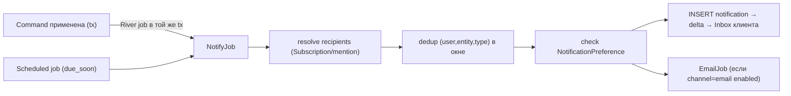

# Архитектура: Нотификации

Генерация Inbox-уведомлений из доменных событий + доставка по каналам.
Связано: §8.1.8, [platform](../01-domain/platform.md) (Notification/Preference), River (ADR-0003 S3).

---

## 1. Источники событий → типы нотификаций

| Триггер | Тип | Получатели |
|---|---|---|
| Назначение issue | `assigned` | новый assignee |
| Упоминание `@user` в comment/description | `mentioned` | упомянутые |
| Смена статуса issue | `state_changed` | подписчики (Subscription) |
| Новый комментарий | `commented` | подписчики |
| Приближение `due_date` | `due_soon` | assignee/подписчики |
| Любое обновление подписанного issue | `subscribed_update` | подписчики |

Авто-подписка (Subscription): assign, комментирование, создание → подписывают пользователя.

---

## 2. Конвейер генерации

- Джоба ставится **транзакционно** с командой (River, ADR-0003) → событие не теряется.
- `resolve recipients`: подписчики issue + упомянутые; исключаем актора (себе не шлём).
- **Дедуп** по `(user_id, entity_id, type)` в окне (черновик: коалесить серию правок за N минут).
- `due_soon` — scheduled job сканирует `due_date` в горизонте (напр. «в течение 24ч») по подписанным/назначенным.

---

## 3. Доставка по каналам

- `in_app` — всегда: INSERT в `notifications` → дельта → Inbox клиента (синкается, §sync-protocol).
- `email` — отдельная `EmailJob`, гейтится `NotificationPreference(type, channel=email, enabled)`.
- MVP email — минимум: `assigned`, `mentioned`, `due_soon`. Остальное расширяется позже.
- push — после MVP.

---

## 4. Прочтение и синк

- `MarkRead`/`MarkAllRead` — команды (§commands); меняют `read_at`, отражаются в `change_log` → синк между клиентами (прочитал на одном — пропало на другом).
- Inbox = запрос Filter AST по `notifications` (непрочитанные/все/по типу) — переиспользует query-движок.

## Открытые микро-вопросы

- Окно дедупа/коалесинга (минуты) — дефолт-черновик, тюнить.
- Digest-уведомления (сводка за период) — после MVP.
- `snoozed_until` (отложить) — поле есть, UI опционален в MVP.
