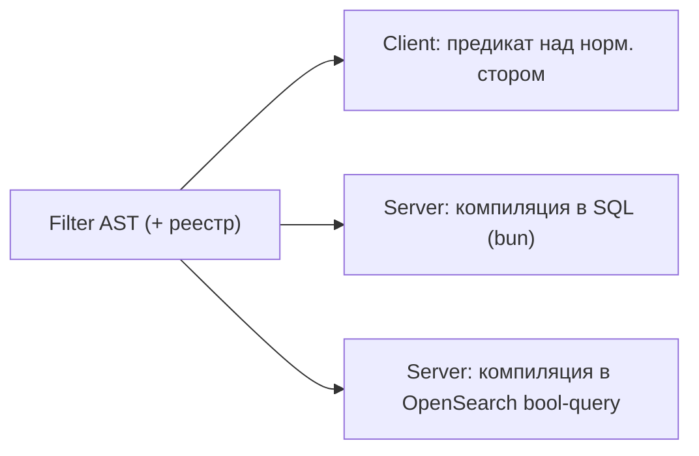

# Архитектура: Query Engine (Filter AST)

Единый язык запросов для views, виджетов, поиска, сохранённых фильтров (§6.2).
Один сериализуемый AST → **три исполнителя**: клиентский стор, SQL (bun), OpenSearch.
Связано: §6.2, §6.3, §6.4, §7.6, §10.3. Хранение View — [views-dashboards](../01-domain/views-dashboards.md).

---

## 1. Грамматика AST

```ts
type FilterNode =
  | { type: 'and';  children: FilterNode[] }
  | { type: 'or';   children: FilterNode[] }
  | { type: 'not';  child: FilterNode }
  | { type: 'predicate'; field: FieldRef; op: Operator; value: FilterValue };

type FieldRef =
  | { kind: 'builtin'; key: BuiltinField }
  | { kind: 'custom';  fieldId: string };

type Operator =
  | 'eq' | 'neq' | 'in' | 'nin'
  | 'lt' | 'lte' | 'gt' | 'gte'
  | 'contains' | 'startsWith'
  | 'isSet' | 'isNotSet'
  | 'before' | 'after' | 'withinNext' | 'withinPast';

type FilterValue = string | number | boolean | string[] | RelativeDate | null;
type RelativeDate = { unit: 'day'|'week'|'month'; amount: number };
```

Инварианты дерева: `and/or` ≥1 ребёнок; `not` ровно один; пустой фильтр = `{type:'and',children:[]}` (всё проходит).
AST **сериализуем** (хранится в `views.filter`, едет в URL, по проводу через ConnectRPC).

---

## 2. Реестр полей (schema per data_source)

Источник истины — таблица допустимых полей, их типов и операторов **на каждый `data_source`**.
Один реестр на сервере (Go) и на клиенте (TS), генерируемый из общего описания (proto/codegen),
чтобы валидация и компиляция совпадали.

| Поле (issue) | Тип | Операторы |
|---|---|---|
| `status` (state_id) | ref | eq, neq, in, nin, isSet |
| `state.category` | enum | eq, in |
| `assignee` | ref(user) | eq, in, isSet, isNotSet |
| `priority` | enum(0-4) | eq, in, lt, gt, gte, lte |
| `label` | ref[] m2m | in, nin (any/all — флаг) |
| `cycle` / `project` / `parent` | ref | eq, in, isSet, isNotSet |
| `creator` | ref(user) | eq, in |
| `estimate` | number | eq, lt, lte, gt, gte, isSet |
| `createdAt`/`updatedAt`/`dueDate`/`startDate`/`scheduledDate` | date | lt/gt/lte/gte, before, after, withinNext, withinPast, isSet |
| `title`/`description` | text | contains, startsWith |
| `hasRelation` | special | eq(type), isSet |
| `subscriber` | ref(user) | in (текущий пользователь и т.п.) |
| custom `{fieldId}` | по типу поля | по типу (relationship → eq/in/isSet; см. ADR-0004) |

Другие `data_source` (`doc`/`project`/`cycle`/`activity`) имеют свои реестры (расширяемо).

### Валидация (модуль Views, перед сохранением и исполнением)

- Поле существует в реестре `data_source`.
- Оператор допустим для типа поля.
- `value` соответствует оператору (`in` → массив; `withinNext` → RelativeDate; `isSet` → нет value).
- Custom field существует и его `type` допускает оператор.
- Невалидный AST → ошибка до исполнения (никогда не доходит до трёх компиляторов).

---

## 3. Три исполнителя и контракт эквивалентности



**Требование (§10.3): три исполнителя дают одинаковый набор результатов** на одинаковых данных.
Покрывается property-based контрактными тестами: генерируем случайные валидные AST + наборы issues,
сверяем результаты client vs SQL vs OpenSearch. Любое расхождение — баг.

### 3.1. Клиентский исполнитель

- Чистая функция `match(node, entity, ctx): boolean` над нормализованным стором (Pinia).
- `ctx` резолвит относительные даты (`now`, таймзона пользователя), `currentUser` (для `subscriber`).
- Мгновенная фильтрация без сервера (§7.4); виртуализация поверх результата.

### 3.2. SQL-компилятор (bun)

- `predicate → SQL-фрагмент` + параметры (никогда не конкатенация значений — только bind).
- Builtin-поля → колонки `issues`. `label` (m2m) → `EXISTS (SELECT 1 FROM issue_labels …)`.
- `state.category` → JOIN/подзапрос на `workflow_states.category`.
- Custom field → `EXISTS (SELECT 1 FROM custom_field_values v WHERE v.issue_id=… AND v.field_id=… AND <jsonb-предикат>)`; GIN-индекс по `value`.
- `relationship` custom → предикат по target-id внутри `value` (eq/in/isSet).
- Относительные даты резолвятся **на момент компиляции** в абсолютные границы (с таймзоной воркспейса/пользователя) — детерминизм для контрактных тестов.
- `and/or/not` → `(… AND …)`/`(… OR …)`/`NOT (…)`.
- Всегда инжектится скоуп `workspace_id` + видимость (RBAC, §rbac) поверх пользовательского фильтра.

### 3.3. OpenSearch-компилятор

- `predicate → bool query` (`filter`/`must`/`must_not`/`should`).
- Полнотекст (`contains` по title/description) — `match`/`match_phrase_prefix`.
- Используется на масштабе и для глобального поиска; индексация — джобами (River) при изменении issue.
- Для MVP допустимо: маленькие воркспейсы обслуживаются SQL/клиентом, OpenSearch включается по порогу (§7.9). Компилятор пишется сразу ради контрактных тестов.

---

## 4. Группировка, сортировка, порядок

Результат запроса = `GroupedResult` (вход всех renderer'ов, §6.3). Один и тот же для board/list/table/calendar.

- **GroupSpec**: поле группировки (`status/assignee/priority/cycle/label/project/custom`) → колонки board / секции списка / swimlanes (subGrouping).
- **OrderSpec[]**: сортировка (поле + направление). Ручной порядок (`board_position`/`sub_position`) — спец-сортировка по fractional-ключу.
- Группировка по m2m (`label`) → issue может попасть в несколько групп (определяем поведение: дублирование в каждую группу).
- Пустые группы значимы для board (колонка статуса без issues видна).

---

## 5. Метрики и агрегации (Stat/Chart-виджеты)

`MetricSpec`/`ChartSpec` (§6.4) — агрегация **поверх того же AST** → консистентность с фильтрами.

```ts
type MetricSpec = { agg: 'count'|'sum'|'avg'; field?: BuiltinField|CustomRef; filter: FilterNode };
type ChartSpec  = { kind: 'burndown'|'velocity'|'groupedCount'; groupBy?: FieldRef; filter: FilterNode; window?: RelativeDate };
```

- `count`/`sum`/`avg` → SQL агрегаты с тем же WHERE, что компилятор фильтра.
- `burndown`/`velocity` → из `cycle_progress_snapshots` (§planning), не live-скан.
- `groupedCount` → `GROUP BY` по полю; используется в chart-виджетах.
- Тяжёлые агрегации кэшируются/инкрементальны (§7.9).

---

## 6. Пагинация / производительность

- Keyset-пагинация по `id` (UUIDv7 k-sortable) или по полю сортировки — не OFFSET.
- Списки на тысячи issues: клиент фильтрует над стором (без сервера); сервер — для server-side экспорта/масштаба.
- Индексы: ведущий `(workspace_id, team_id)` + поля частых предикатов (status, assignee, cycle, dates) (§7.8/7.9).

## Открытые микро-вопросы

- `label in` — семантика any vs all: флаг в value (`{mode:'any'|'all'}`). По умолчанию any.
- Порог переключения SQL→OpenSearch (кол-во issues/воркспейс) — настраиваемый, дефолт уточняется на perf-тестах.
- Группировка по custom multiselect — поведение дублирования в группы (как у label).
