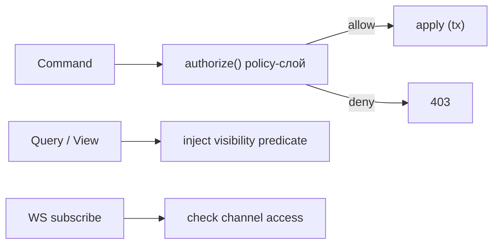

# Архитектура: RBAC и видимость

Серверный policy-слой — **единственный источник истины** (§7.7). Клиент получает
производную permission-карту для гейтинга UI; сервер всегда перепроверяет.
Связано: §7.7, [identity-access](../01-domain/identity-access.md), [teams-config](../01-domain/teams-config.md).

---

## 1. Три уровня прав

### Workspace
Роли `owner / admin / member / guest` (матрица — в [identity-access](../01-domain/identity-access.md)).

### Team
- Приватность `public / private`; роли `lead / member`.
- private-команда не видна не-членам (ни в дереве, ни в поиске, ни в дельтах).

### Resource
| Ресурс | Видимость |
|---|---|
| Issue | наследует видимость своей команды |
| Doc / Dashboard / View | собственный scope (`personal/team/workspace`) + флаг `shared` |
| Comment / Attachment | наследует от родительской сущности |

---

## 2. Наследование при вложенности команд (ADR-0004 #2)

Политика — `workspace.settings.teamNestingPolicy`:

| Политика | Поведение |
|---|---|
| `inherit-public` (дефолт) | член родительской команды **видит public-дочерние**; private-дочерние требуют явного членства |
| `strict` | каждая команда изолирована; членство не наследуется |

- Наследование вычисляется по `teams.path` (ltree) + политике.
- `rollupDescendants` во View показывает issues дочерних команд **только тех, что видимы** по политике.

---

## 3. Точки проверки

- **Каждая команда** проходит `authorize()` перед `apply` (§sync-protocol 2). Нет авторизации мимо команд.
- **Каждый запрос** (Filter AST) получает инжекцию предиката видимости поверх пользовательского фильтра (§query-engine 3.2) — пользователь не может «отфильтровать» то, что видеть не вправе.
- **WS-подписка** проверяет доступ к каналу ([realtime](realtime.md) §2).

---

## 4. Permission-карта для клиента

- Сервер отдаёт клиенту **производную карту прав** (что можно создавать/редактировать/видеть в текущем скоупе) для гейтинга UI (скрыть кнопки, заблокировать действия).
- Карта — **подсказка для UX**, не граница безопасности: сервер перепроверяет на каждой мутации.
- Карта синкается/инвалидируется при смене ролей/членств (через дельты).

---

## 5. Гость (guest)

- Видит только явно расшаренное (`shared` ресурсы) или назначенное (issue, где он assignee/subscriber).
- Не получает `workspace:{id}`-дельты целиком — только по доступным сущностям.
- Не видит дерево команд.

---

## 6. Inherited-членства: материализация

Открытый вопрос из [teams-config](../01-domain/teams-config.md):

| Вариант | За | Против |
|---|---|---|
| **Вычислять на лету** (по `path`+политика) | всегда свежо, нет дублирования | стоимость на каждом запросе видимости |
| **Материализовать** (таблица effective_memberships) | быстрый чек | инвалидация при move/смене политики/членства |

**Решение MVP:** вычислять на лету + кэш в Redis (горячие справочники, §7.9), инвалидация по событиям
членства/перемещения. Материализованную таблицу вводим, только если перф упрётся (потолок зафиксирован).

## Открытые микро-вопросы

- Кастомные роли (за пределами owner/admin/member/guest) — после MVP.
- Гранулярные права на отдельные действия (напр. «только комментировать») — после MVP; MVP = ролевые наборы.
- Шаринг ресурса конкретным пользователям (а не только scope) — нужен ли в MVP (по умолчанию: scope + shared-флаг, точечный шаринг позже).
