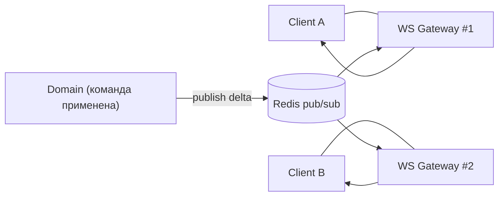

# Архитектура: Realtime

WS-доставка дельт и presence. Транспорт под sync-протокол (§7.5).
Стек: **coder/websocket** (ADR-0003 S4), fan-out через Redis pub/sub.
Связано: §7.5, [sync-protocol](sync-protocol.md).

---

## 1. Транспорт

- **WebSocket** на coder/websocket; апгрейд аутентифицируется по токену (тот же, что REST/Connect).
- **Goroutine на соединение** (сильная сторона Go, §7.4): read-pump + write-pump + ticker heartbeat.
- Ping/pong heartbeat; мёртвые соединения закрываются по таймауту.
- Stateless-инстансы за балансировщиком; соединение может попасть на любой инстанс (§9.2).

---

## 2. Каналы подписки

| Канал | Когда |
|---|---|
| `workspace:{id}` | всегда (справочники, кросс-командные события) |
| `team:{id}` | открыт экран команды / есть доступ |
| `issue:{id}` | открыт конкретный issue (modal/overlay) |
| `presence:{entity}` | presence на сущности (v2 для печати; в MVP — «кто смотрит») |

- Клиент управляет подписками по **открытому экрану** (subscribe/unsubscribe сообщения).
- Сервер проверяет право на канал при подписке (RBAC, [rbac](rbac.md)) — нельзя подписаться на чужую private-команду.

---

## 3. Fan-out между инстансами

- Доменный слой после коммита публикует дельту в Redis-канал (`workspace:{id}` и т.д.).
- Каждый WS-инстанс подписан на Redis и ретранслирует своим локальным соединениям, отфильтровав по их подпискам.
- Клиент на любом инстансе получает дельту → горизонтальное масштабирование без липких сессий по данным.

---

## 4. Presence

- Эфемерное состояние в Redis: ключ `presence:{entity}` → set пользователей с TTL + heartbeat (§7.5).
- «Кто смотрит» — MVP; «печатает» — v2 (чаты/совместное редактирование).
- Не персистится в Postgres (чистый runtime).

---

## 5. Батчинг и throttling

- Дельты коалесятся в окне **~50–100мс** перед отправкой клиенту → bulk-операции (multi-select, реордер) не штормят (§7.5).
- Несколько апдейтов одной сущности в окне → последняя версия.
- Backpressure: если клиент не успевает читать — дропаем до «пересинка» (клиент запрашивает `since=cursor`), а не копим неограниченно.

---

## 6. Типы сообщений (клиент↔сервер)

| Направление | Тип | Назначение |
|---|---|---|
| C→S | `subscribe` / `unsubscribe` | управление каналами |
| C→S | `ping` | heartbeat |
| S→C | `delta` | изменение сущности (§sync-protocol 4) |
| S→C | `presence` | обновление presence |
| S→C | `pong` / `resync_required` | heartbeat / требование догона |

Команды-мутации идут **не** по WS, а через ConnectRPC (write-path); WS — только подписки + входящие дельты/presence.
(CQRS-разделение §7.6: write через Command API, read/stream через WS.)

## Открытые микро-вопросы

- Размер окна батчинга (50 vs 100мс) — тюнится на realtime-тестах (§10).
- Лимит каналов на соединение / лимит соединений на пользователя — настраиваемый.
- Сжатие WS-фреймов (permessage-deflate) — включить при больших дельтах, замерить.
