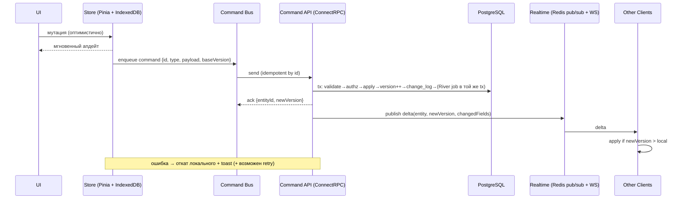

# Архитектура: Sync-протокол (Этап А)

Local-first ощущение через локальную модель данных + оптимистичные мутации + delta-sync
(ADR-0002, §7.4). Самый рисковый и ценный узел. Изоляция за `StoreGateway`/`command bus`
ради дешёвого апгрейда на Этап Б.

Связано: §7.4, §7.5, ADR-0002, ADR-0005 (change_log/version).

---

## 1. Жизненный цикл клиента



### Первичная загрузка (bootstrap)

- Клиент при входе тянет **срез доступных команд**: issues + справочники (workflow_states, cycles, labels, members, teams) + сохранённые views.
- Прогрессивно (§7.9): сначала открытая команда/представление, остальное фоном.
- Срез нормализуется в стор (Pinia) и персистится в IndexedDB.
- Курсор синка (`max(seq)` из применённого `change_log`) сохраняется локально.

---

## 2. Модель команд (не CRUD)

Мутации — типизированные **команды** (§7.6): `CreateIssue`, `UpdateIssueState`, `ReorderIssue`,
`AddLabel`, `AssignIssue`… Конверт:

```ts
interface Command {
  id: string;            // client-generated UUIDv7 → идемпотентность
  type: string;          // 'UpdateIssueState'
  workspaceId: string;
  payload: object;       // типизирован по type (proto)
  baseVersion?: number;  // версия сущности, на которой клиент основывался (для LWW per-field)
}
```

- **Идемпотентность**: сервер хранит обработанные `command.id` (окно дедупа); повторная отправка (после реконнекта) не дублирует эффект.
- Команды описаны в proto → Go-типы + TS-клиент (ADR-0003 S1).
- Каждая команда: `validate → authorize (RBAC) → apply (tx) → version++ → change_log → enqueue side-effect jobs` — всё в одной транзакции (River транзакционен, ADR-0003 S3).

---

## 3. Клиентские абстракции (под апгрейд на Этап Б)

- **`StoreGateway`** — интерфейс над локальным стором (чтение/запись нормализованных сущностей). Реализация MVP = Pinia+IndexedDB; Этап Б = Electric/PowerSync (SQLite/PGlite) без переписывания UI.
- **`command bus`** — единая точка отправки мутаций (enqueue, optimistic apply, retry, rollback). Транспорт (ConnectRPC) подменяем.
- UI и доменная логика **не знают** транспорта/движка — зависят только от этих двух интерфейсов.

---

## 4. Дельты и догон

### Формат дельты (из `change_log`, §ADR-0005)

```ts
interface Delta {
  seq: number;            // курсор
  entityType: string;
  entityId: string;
  version: number;        // новая версия
  op: 'create'|'update'|'delete'|'archive';
  changedFields?: object; // для update — изменённые поля
}
```

### Применение на клиенте

- `apply(delta)`: если `delta.version > local.version` → мержим `changedFields`, обновляем `version`; иначе игнор (старая).
- `delete`/`archive` → tombstone/флаг в сторе.
- Свои оптимистичные изменения, уже подтверждённые ack, не откатываются приходящей дельтой (сверка по version).

### Догон после оффлайна

- Реконнект → `GET changes since=<cursor>` (по `change_log.seq` в рамках подписанных каналов/workspace).
- Применяем пропущенные дельты по порядку `seq`.
- Затем **доигрываем свою очередь** отложенных команд (см. §5).
- Если объём догона велик (долгий оффлайн) → fallback на повторный bootstrap среза.

---

## 5. Очередь отложенных мутаций (offline)

- Очередь команд персистится в IndexedDB → переживает перезагрузку/реконнект (§9.7).
- Порядок сохраняется (FIFO per-entity минимум); отправка при восстановлении связи.
- Идемпотентность по `command.id` защищает от двойного применения при «отправил, но не получил ack».
- Команда несёт `baseVersion` — сервер разрешает конфликт по полям (см. §6), не теряя чужих изменений.

---

## 6. Конфликты

| Тип данных | Стратегия |
|---|---|
| Структурные поля issue/project (status, assignee, priority, dates…) | **per-field LWW** по `version`/`updated_at`; команда несёт `baseVersion`, сервер применяет только реально изменённые поля, не затирая несвязанные |
| Ручной порядок (`position`) | fractional indexing разводит конкурентные вставки без коллизии; при равенстве — tie-break по `id` |
| Свободный текст (description, doc body, comment) | MVP — **LWW по полю**; CRDT (Yjs) — отдельная веха (ADR-0004 #9) |

**Per-field LWW детально:** команда `UpdateIssue{baseVersion, fields:{priority:3}}`. Сервер:
если `current.version == baseVersion` — применяет; если разошлось — применяет только поля из команды
(priority), оставляя поля, изменённые другим клиентом (assignee), нетронутыми. Конфликт ровно того же
поля → побеждает последний по `updated_at`. Это TDD-узел (§10.1).

---

## 7. Каналы и подписки (связь с realtime)

- Дельты публикуются в каналы `workspace:{id}`, `team:{id}`, `issue:{id}` (§7.5).
- Клиент подписывается по открытому экрану; детали транспорта — [realtime](realtime.md).
- Батчинг дельт (окно ~50–100мс) против шторма при bulk-операциях.

---

## 8. Апгрейд на Этап Б (что остаётся стабильным)

- Схема `change_log`/`version`/курсоров — переносима на Electric/PowerSync (они тоже читают Postgres-реплики/WAL).
- `StoreGateway` и `command bus` — точки подмены; UI/домен не трогаются.
- Команды (write-path) могут остаться поверх ConnectRPC даже при смене read/sync-движка (CQRS-разделение, §7.6).

## Открытые микро-вопросы

- Окно дедупа `command.id` (TTL хранения обработанных id) — дефолт-черновик 24ч; уточнить.
- Порог «догон vs повторный bootstrap» (сколько пропущенных seq) — настраиваемый.
- Гранулярность `baseVersion`: на сущность (выбрано) vs на поле — на сущность достаточно для per-field LWW.
- Сжатие/коалесинг очереди (несколько апдейтов одного поля → последний) — оптимизация, не MVP-блокер.
