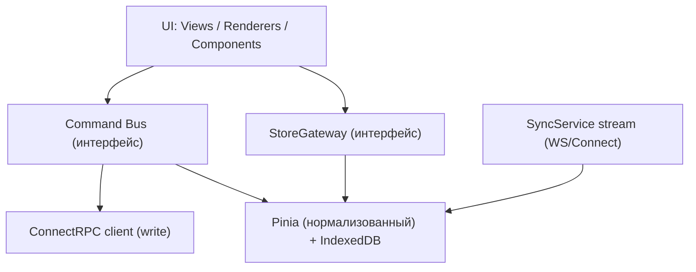

# Фронтенд: Локальный стор, StoreGateway, Command Bus

Нормализованный локальный стор — основа «локального» ощущения (§7.4, ADR-0002).
Стек: Nuxt 3 + Pinia + IndexedDB. Изоляция за `StoreGateway`/`command bus` под апгрейд на Этап Б.
Связано: [sync-protocol](../02-architecture/sync-protocol.md), §7.2, §7.4.

---

## 1. Слои



UI зависит **только** от `StoreGateway` (чтение) и `command bus` (запись) — не от Pinia/транспорта напрямую.
Это точка подмены на Этап Б (Electric/PowerSync) без переписывания UI.

---

## 2. Нормализованный стор

- Сущности хранятся по `id` в словарях (`issues: Record<id, Issue>`, `states`, `cycles`, `labels`, `members`, `teams`, `views`…).
- Связи — по id (не вложенные объекты); сборка для рендера — селекторами/computed.
- Filter AST исполняется клиентом **над этим стором** (§query-engine 3.1) — мгновенная фильтрация без сервера.
- Персистенс в IndexedDB (`idb`): стор переживает перезагрузку; bootstrap при первом входе, далее — дельты.

### StoreGateway (интерфейс)

```ts
interface StoreGateway {
  get<T>(type: EntityType, id: string): T | undefined;
  query(def: ViewDefinition): GroupedResult;        // фильтр+группировка+сортировка над стором
  upsert(type: EntityType, entities: object[]): void; // применение дельт/bootstrap
  applyDelta(delta: Delta): void;                    // version-gated merge
  subscribe(selector): Ref;                          // реактивность для UI
}
```

---

## 3. Command Bus

```ts
interface CommandBus {
  dispatch(cmd: Command): Promise<CommandResult>;   // optimistic apply → send → ack/rollback
}
```

Поток (§sync-protocol 2):
1. **Optimistic apply** — мутация применяется к стору сразу (UI обновляется <50мс, §9.1).
2. **Enqueue** — команда с `id`(UUIDv7)+`baseVersion` в персистентную очередь (IndexedDB).
3. **Send** — через ConnectRPC; `Idempotency-Key = cmd.id`.
4. **Ack** — обновить `version`; убрать из очереди.
5. **Ошибка** — откатить оптимистичное изменение + toast (+ опц. retry для `aborted`).
6. **Offline** — команды копятся в очереди, доигрываются при реконнекте.

---

## 4. Применение дельт (входящие)

- `SyncService`-поток (WS) приносит дельты; `applyDelta` мержит, если `version` новее (§sync-protocol 4).
- Свои подтверждённые изменения не откатываются приходящей дельтой (сверка по version).
- Bootstrap/догон: `since=cursor` → пакет дельт → `upsert`.

---

## 5. Реактивность и производительность

- Selectors/computed собирают view-модели из нормализованного стора; пересчёт только при изменении зависимостей.
- Списки виртуализируются (S5: `@tanstack/vue-virtual`) — рендерится только видимое (§9.1).
- Индикатор синка (онлайн/оффлайн/догоняем) — из состояния command bus + соединения (§5.5).

## Открытые микро-вопросы

- Селекторный слой: ручные computed vs lib (Pinia Colada/TanStack Query для server-state не-синк эндпоинтов). По умолчанию: синк-данные — стор+селекторы; редкие не-синк запросы — `$fetch`.
- Шифрование IndexedDB (§9.7) — опционально, по требованию.
- Стратегия инвалидации производных permission-карт при смене ролей — через дельту members.
