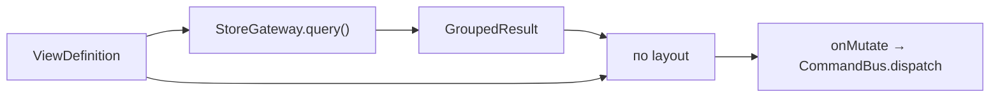

# Фронтенд: View ↔ Renderer контракт

Реализация принципа «всё есть ViewDefinition + renderer» (§6). Одна страница Issues,
сохранённый View, виджет дашборда и встроенный список — **один механизм**, нет спец-кода.
Связано: §6.1, §6.3, §6.5, [query-engine](../02-architecture/query-engine.md), [views-dashboards](../01-domain/views-dashboards.md).

---

## 1. Конвейер рендера



- `ViewDefinition` (§6.1) → `StoreGateway.query()` исполняет Filter AST + группировку + сортировку над локальным стором → `GroupedResult`.
- `GroupedResult` — **одинаковый вход** для всех renderer'ов; отличается только визуализация.
- Мутации из renderer (DnD, inline-edit) → `onMutate` → command bus (оптимистично).

---

## 2. Контракт renderer'а

```ts
interface ViewRenderer {
  layout: Layout;                          // 'board' | 'list' | 'table' | 'calendar'
  supportedGroupings: FieldRef['kind'][];
  render(props: {
    result: GroupedResult;
    def: ViewDefinition;
    onMutate: (cmd: Command) => void;
  }): VNode;
}
```

Добавление способа отображения = новый renderer, **без** изменения модели View или query-движка (§6.3).
Timeline — пятый renderer, добавляется в раннем v2 (ADR-0004) по этому же контракту.

---

## 3. Renderer'ы MVP

| Renderer | Layout | Особенности |
|---|---|---|
| **BoardRenderer** | board | колонки = значения `grouping`; DnD между колонками меняет поле группировки (напр. status → команда `UpdateIssueState`); вертикальный порядок = `board_position` (fractional → `ReorderIssue`) |
| **ListRenderer** | list | сгруппированный список; виртуализация; inline-edit; раскрываемые группы; sub-issues nested |
| **TableRenderer** | table | колонки = свойства + custom fields; ресайз/реордер колонок; сортировка по клику |
| **CalendarRenderer** | calendar | месяц/неделя; issues по `scheduled_date`/`due_date`; DnD = смена даты (`SetDates`) |

- Все потребляют `GroupedResult`; группировка по m2m (label) → issue в нескольких группах (§query-engine 4).
- Пустые группы значимы (board-колонка без issues видна).
- DnD — S5: pragmatic-drag-and-drop. Каждый drop → оптимистичная команда.

---

## 4. Один компонент — много мест (§6.4)

- **Полноэкранная страница** (`/team/:key/issues`, `/team/:key/view/:id`) = `<ViewHost :def>`.
- **ViewWidget** на дашборде = тот же `<ViewHost :def>` в ячейке grid → нет дублирующего кода.
- **Встроенный список в доке** = `<ViewHost :def inline>`.
- Дефолтная страница Issues команды = `ViewDefinition` с `grouping:status` — собирается из стора, спец-кода нет (§6.1).

---

## 5. Display options и временные views

- Панель **Display options** правит `ViewDefinition` (видимые свойства, плотность, sub-issues, completed, rollup) — локально, мгновенно (§8.1.5).
- Изменения несохранённого View живут в URL query (§4.3) → шаринг ссылкой; «Save» = команда `CreateView`/`UpdateView`.
- FilterBar строит/редактирует Filter AST визуально.

## Открытые микро-вопросы

- Реестр renderer'ов: статический объект vs плагинная регистрация. По умолчанию статический map `layout → renderer`.
- TableRenderer: своя реализация DataGrid (Nuxt UI не покрывает) — кастомный компонент (§5.3).
- Calendar — кастомный под минимал-стиль (S5) vs Schedule-X; решаем в [components](components.md).
