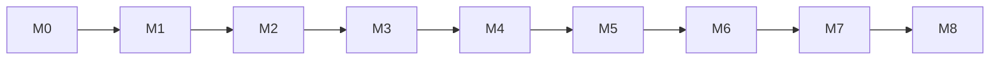

# Дорожная карта реализации MVP

Последовательность вех; каждая — работающий вертикальный срез (§11). M0–M3 = «движок»
(модель + синк + Filter AST + renderer'ы): самый рисковый и ценный участок, максимум TDD/контрактных тестов.

| Веха | Содержание | Критерии приёмки (DoD) |
|---|---|---|
| **M0 Фундамент** | auth (opaque/Redis), workspace, teams, модель данных + миграции, локальный стор + **скелет синка** (change_log/version/каналы), proto/ConnectRPC-каркас, RLS | вход → создание воркспейса/команды; стандартные колонки + change_log на месте; пустой клиент бутстрапит срез |
| **M1 Issues + List** | CRUD, `KEY-N`, свойства, inline-edit, ListRenderer | создать issue → корректный идентификатор; правка свойств оптимистична и синкается |
| **M2 Board + Workflow** | статусы/категории, DnD, fractional ordering, авто `started_at/completed_at` | drag между колонками меняет статус и порядок; метки времени проставляются |
| **M3 Views** | **Filter AST** (3 исполнителя + контрактные тесты), группировки/сортировки, сохранённые views, display options, TableRenderer, базовый Cmd-K | фильтр+группа+сорт сохраняется/переоткрывается; три движка эквивалентны |
| **M4 Планирование** | cycles, projects, labels, sub-issues, relations (зеркала), burndown (снапшоты) | issues в цикле → корректные scope/burndown; relations зеркалятся |
| **M5 Calendar** | месяц/неделя, DnD-перепланирование (CalendarRenderer) | drag на дату меняет `scheduled/due`, отражается в списке |
| **M6 Кастомизация** | custom fields (база+relationship), дашборды/виджеты (View/Stat/Chart/Note), настраиваемый рейл | custom field фильтруется и виден в таблице; ViewWidget == полноэкранный View |
| **M7 Платформа** | поиск/quick-switch, Inbox/нотификации, docs, **realtime доводка** (Этап А), presence | изменение в A видно в B; Inbox наполняется; поиск находит |
| **M8 Полировка** | perf, a11y (axe), visual QA, empty states, бюджеты бандла/TTI | критические E2E зелёные; TTI/бандл в бюджете; axe без критичных |

---

## Замечания по последовательности (§11)
- **M0–M3 — «движок»**: здесь TDD и контрактные тесты окупаются больше всего.
- **Realtime** в M0 — скелет (каналы/дельты на уровне инфраструктуры), доводка в M7; оптимистичный UI работает локально с самого начала.
- **Базовый Cmd-K** (create/quick-switch) — раньше (M3–M4), даже если «полный» палитра — v2.
- **Calendar (M5)** можно вести параллельно с M4 — это ещё один renderer над тем же движком.

## Связь с открытыми решениями
- Этап Б local-first (Electric/PowerSync/Zero) — **после** MVP; M0 уже изолирует стор за `StoreGateway` ради дешёвого апгрейда (ADR-0002).
- v3+ (git/CI/IDE/AI) встраиваются по границам модулей ([modules](02-architecture/modules.md)); детальные спеки — ближе к делу.
